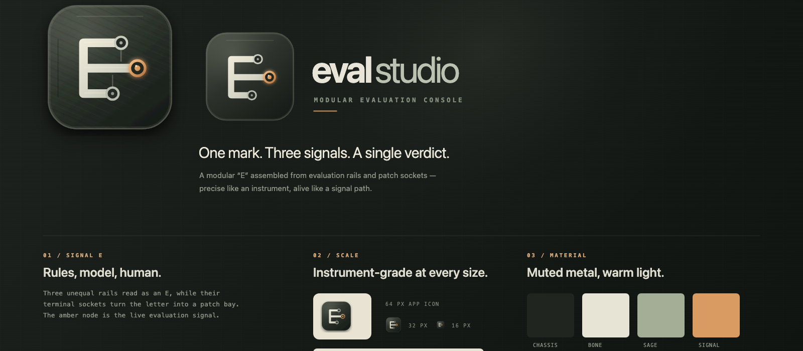
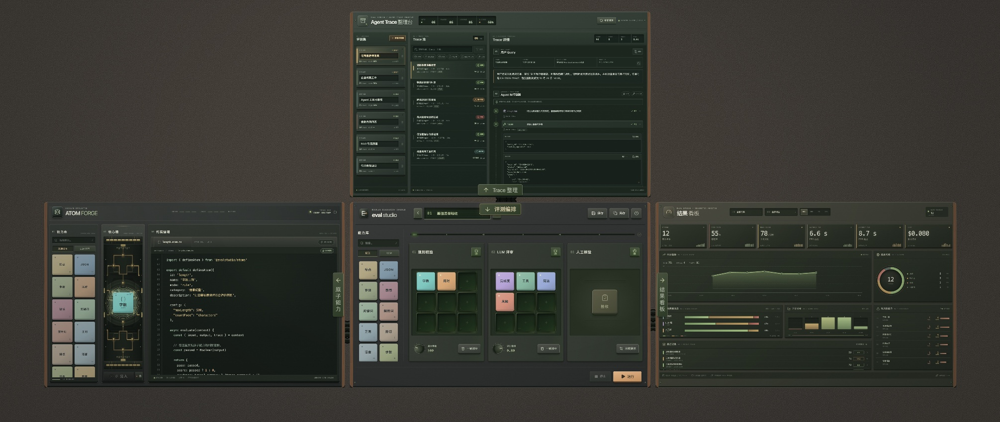
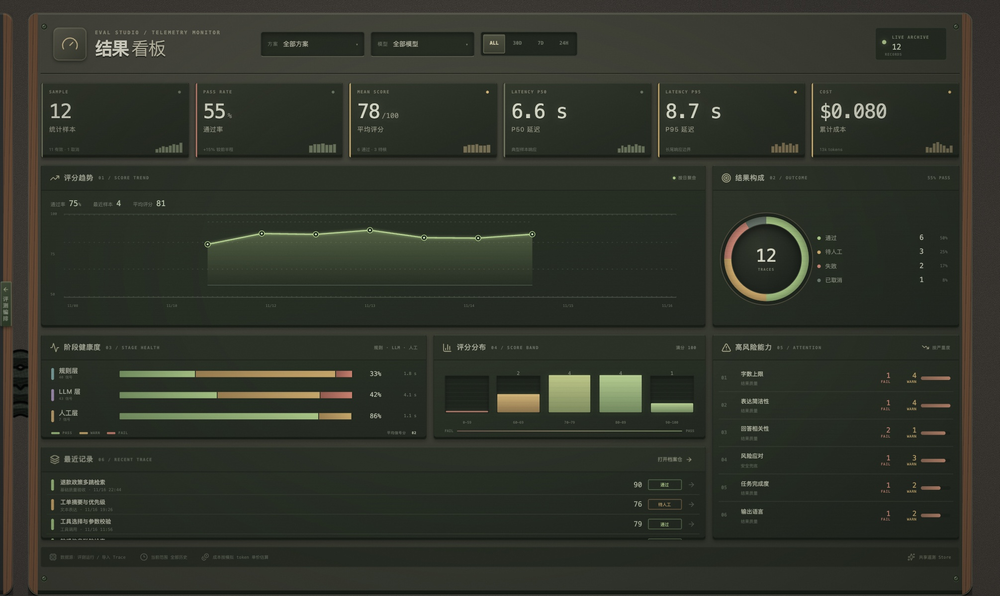
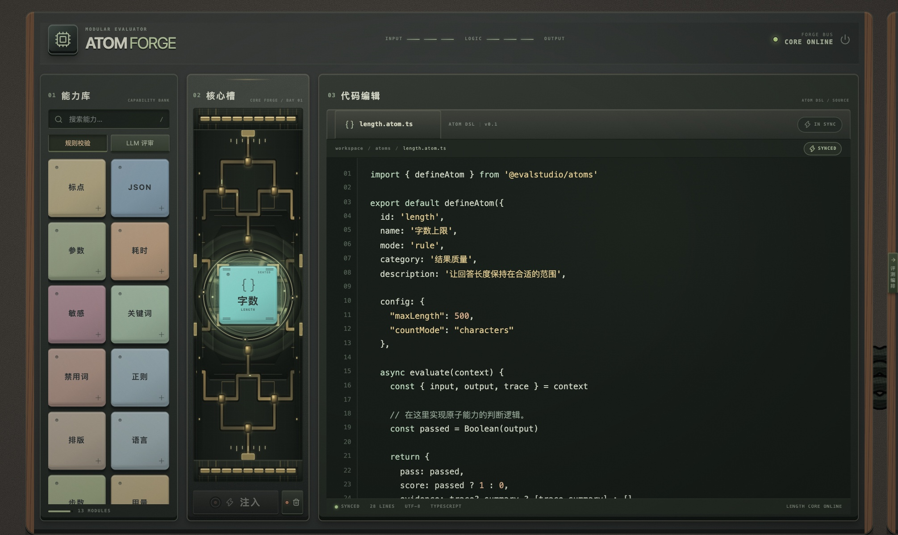

  

  <h1>Eval Studio</h1>

  **Compose evaluation. Don’t configure it.**

  An 80s synth-inspired, modular workbench for composing Agent evaluations 
  from rules, LLM judges, and human review.

  
  
  
  
  

> **中文简介**  
> Eval Studio 是一款 80 年代合成器风格、搭积木式 Agent 评测工作台。你可以像装载效果器一样，把规则校验、LLM 评审与人工核验拖入信号链，再通过 Trace 整理、结果看板和原子能力锻造台完成从编排、观察到扩展的完整闭环。

## Why Eval Studio

Most evaluation tools treat an eval as a form to fill in.

Eval Studio treats it as a **signal chain**.

Choose the instruments, patch them into a deliberate order, run the chain, then follow the evidence through traces and telemetry. The interface borrows the physicality of a modular synth not as decoration, but as a way to make composition, state, and causality legible.

It is an opinionated answer to a practical question: **what would Agent evaluation feel like if it were designed as a creative instrument?**

## One desk. Four instruments.

Every workspace lives on the same hardware desk. Textured cables connect the instruments; navigation happens in space rather than through a conventional sidebar.

| Instrument | Purpose | Working capabilities |
| --- | --- | --- |
| **Eval Composer** | Build the evaluation chain | Drag rule and LLM evaluator pads across their 3×3 racks, configure parameters, order the three stage channels, save presets, and complete human acceptance |
| **Trace Archive** | Inspect what happened | Filter archived traces, read the Agent execution chain, inspect tool inputs and outputs, examine raw evidence, and annotate review findings |
| **Telemetry Monitor** | Read the system | Track pass rate, mean score, latency, cost, stage health, score distribution, high-risk capabilities, and recent traces |
| **Atom Forge** | Extend the instrument | Pull capabilities from the bank, seat one in the circuit-style core slot, edit its TypeScript atom definition, and inject the revised logic |

## Product tour

### A desk, not a dashboard

The four panels share one spatial model. Move between them with trackpad gestures, arrow keys, or the visible hardware controls. The desk remains continuous rather than resetting between views.

### Compose the evaluation chain

Evaluator blocks can be moved between slots, swapped, enabled, configured, and returned to the bank. Rules and LLM judges execute in channel order; human acceptance is the final stage when enabled. Presets preserve arrangement, parameters, and stage state.

### Read the evidence, not just the verdict

A failing score is only a symptom. The Trace workspace exposes thoughts, tool calls, inputs, outputs, timing, errors, and supporting evidence in one continuous review surface.

### See the system behind the score

The results dashboard aggregates runs into operational signals: pass rate, score trend, P50/P95 latency, cost, stage health, score bands, and the capabilities that fail most often.

### Forge new evaluator atoms

Atom Forge turns evaluator authoring into a deliberate hardware ritual. A capability block drops into the illuminated core slot, its atom definition opens in the TypeScript editor, and the inject key confirms the modified logic back into the instrument.

## What works today

- **Modular evaluation design** — 28 built-in rule and LLM evaluator templates across quality, process, cost, and safety categories.
- **A real composition model** — fixed rack slots, ordering, enable/bypass state, per-evaluator configuration, presets, and human acceptance requirements.
- **Simulated execution lifecycle** — sequential stage progress, cancellation, generated traces, and a completed human-review path.
- **A trace review surface** — archived demo traces, search and quick filters, execution timelines, tool payload evidence, raw JSON, copy actions, and annotations.
- **A telemetry surface** — computed metrics, trends, outcome composition, stage health, score distribution, risk ranking, and recent trace drill-down.
- **An atom authoring flow** — capability bank, circuit core slot, syntax-highlighted TypeScript editor, modified state, and injection confirmation.
- **Local persistence** — workspace presets, traces, notes, and telemetry state are stored in the browser with `localStorage`.
- **Spatial interaction** — continuous desk navigation with trackpad gestures, keyboard controls, and a full-desk overview.

## Designed like hardware

The visual system is not a synth skin over a generic admin panel. It is built around a small set of material and interaction rules:

- **Muted chassis, warm signal** — olive metal and bone surfaces carry information; amber is reserved for live energy and primary action.
- **Physical controls over abstract buttons** — pads, rails, knobs, power switches, meters, and injection keys expose state at a glance.
- **Cables as architecture** — matte, uneven cables connect the instruments and make the desk legible as one system.
- **Signal-path color** — rule, LLM, and human stages each keep a stable visual identity across composition, traces, and results.
- **Motion with restraint** — transitions preserve spatial orientation and avoid decorative movement that competes with evaluation work.

## Current status

Eval Studio is an **active front-end prototype**, built with React 19, TypeScript, and Vite.

The current prototype:

- runs the evaluation lifecycle through **simulated executors**;
- does **not** call real models or external evaluation services;
- stores workspace and telemetry state **locally in the browser**;
- has **no backend, account system, or hosted demo**;
- uses seeded demo traces to exercise the Trace and telemetry workspaces.

A completed simulated run demonstrates the intended product flow. It is not a production evaluation result.

## Roadmap

| Horizon | Focus |
| --- | --- |
| **Next** | Real executor adapters, provider/model configuration, server persistence, import/export contracts, and a stable evaluator result schema |
| **Then** | Dataset runners, richer atom runtime, trace ingestion from external agents, comparison runs, and shareable evaluation reports |
| **Later** | Team workspaces, review queues, cost governance, SDK/CLI integration, and an installable public release |

## Source availability

The application source will be published in this repository after the prototype reaches its public release milestone. Until then, this README is the product brief and the screenshots are captured from the working local prototype.

No installation, package, or hosted-service instructions are provided yet.

## License

Eval Studio is released under the [MIT License](./LICENSE).

---

  Built with intent. Tuned by ear. Measured with evidence.

